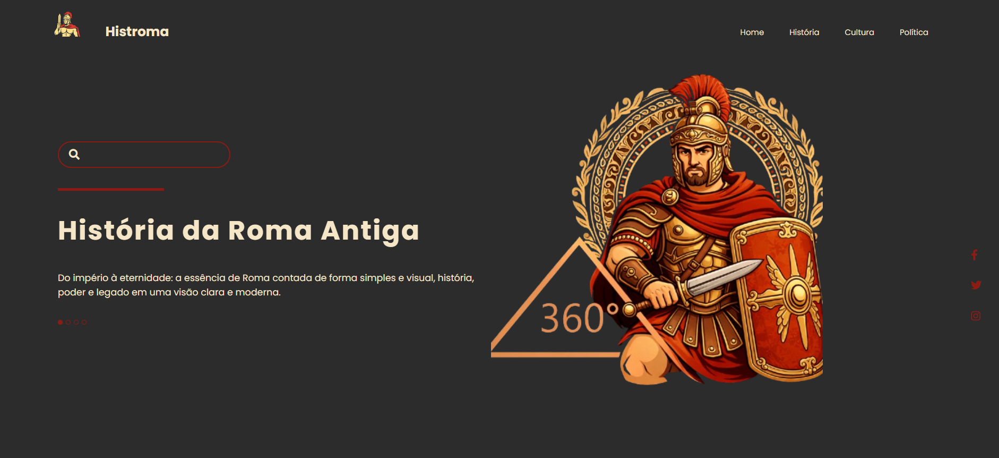

# 🏛️ Landing Page de História — Roma Antiga

Projeto de uma landing page com temática histórica, desenvolvido com **HTML5 e CSS3** como parte de uma atividade prática do curso PROA.

O projeto tem como objetivo explorar a criação de interfaces visuais modernas para sites informativos, utilizando elementos gráficos inspirados na Roma Antiga, organização de conteúdo, menus de navegação, estilização de componentes e composição de layouts com CSS.

## 🖥️ Prévia do projeto

  

🔗 **[Acesse o projeto online](https://gabrielc0liveira.github.io/Projeto24Proa-LandingPageHistoria/)**

## Funcionalidades e características

- Landing page com temática histórica inspirada na Roma Antiga.
- Identidade visual personalizada com o nome Histroma.
- Interface com fundo escuro e detalhes em tons de vermelho e dourado.
- Cabeçalho com logotipo e menu de navegação horizontal.
- Links de navegação para Home, História, Cultura e Política.
- Campo de pesquisa estilizado com ícone de lupa.
- Título principal e descrição introdutória sobre a Roma Antiga.
- Ilustração temática de um soldado romano em destaque.
- Layout organizado em duas colunas utilizando Flexbox.
- Indicadores visuais de navegação.
- Ícones de redes sociais posicionados verticalmente na lateral da página.
- Efeitos visuais de hover nos links do menu.
- Organização dos elementos com posicionamento relativo e absoluto.

## Tecnologias utilizadas

- **HTML5:** estruturação da página, cabeçalho, menu de navegação, campo de pesquisa e organização do conteúdo.
- **CSS3:** estilização, posicionamento, tipografia, cores, efeitos de hover e construção do layout.
- **Flexbox:** organização dos elementos do cabeçalho e distribuição do conteúdo em colunas.
- **Font Awesome:** utilização de ícones de pesquisa e redes sociais.
- **Google Fonts:** utilização da fonte Poppins.

## Aprendizados

Durante o desenvolvimento, foram praticados conceitos como:

- Estruturação de uma landing page utilizando HTML.
- Criação de cabeçalhos com logotipo e menu de navegação.
- Organização de listas de navegação utilizando as tags `nav`, `ul` e `li`.
- Estilização de links com a propriedade `text-decoration`.
- Aplicação de efeitos de interação utilizando a pseudoclasse `:hover`.
- Criação de efeitos de destaque com `border-bottom`.
- Organização de elementos utilizando `display: flex`.
- Distribuição de espaços com `justify-content` e `align-items`.
- Utilização da propriedade `flex-basis` para dividir o conteúdo em colunas.
- Criação e personalização de campos de pesquisa.
- Estilização de formulários com `border`, `outline` e `border-radius`.
- Utilização de posicionamento relativo e absoluto com `position`.
- Centralização vertical de elementos com `transform: translateY()`.
- Aplicação de espaçamentos com `margin`, `padding` e `gap`.
- Personalização de cores utilizando códigos hexadecimais.
- Controle de tipografia com `font-size`, `line-height` e `letter-spacing`.
- Criação de indicadores visuais utilizando elementos `span`.
- Integração de ícones externos com Font Awesome.
- Composição de interfaces com imagens temáticas e elementos decorativos.

## 📂 Como executar o projeto

🔗 **[Acesse o projeto online](https://gabrielc0liveira.github.io/Projeto24Proa-LandingPageHistoria/)**

---

Desenvolvido por **Gabriel Oliveira** como parte das atividades práticas do PROA.
